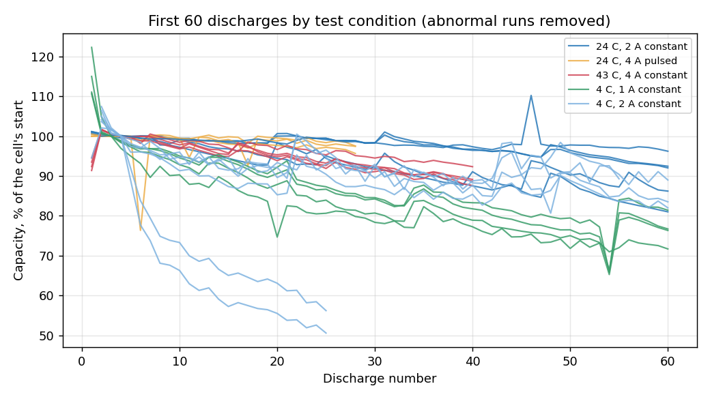

# Li-ion Battery Aging Analysis

How do temperature and load change how fast a lithium-ion cell wears out, and can you tell early which cells will die first?

This project answers both on NASA's public battery aging data: **34 cells (2 Ah 18650s) tested at 4, 24 and 43 °C under 1, 2 and 4 A loads**, some steady and some pulsed, until they wore out. A Python pipeline loads the raw current, voltage, temperature and time readings into SQLite, checks every cycle, computes per-cycle metrics (capacity, energy, efficiency, resistance) and then compares conditions and predicts end of life.

**Why it matters.** Anyone choosing or warrantying cells for a car, drone or backup system needs to know how much capacity cold or heat costs, and running a cell to end of life takes a hundred or more charge cycles. If the first 20 cycles already hint at when a cell will fail, aging tests can be screened early instead of waited out. The answers below are what this data supports, with the limits stated at the end.



## What I found

**Cold cells give less and wear faster.** Median over each group, first 25 discharges, abnormal runs removed:

| Test condition | Cells | Starting capacity | Capacity lost in first 25 discharges (range) |
|---|---|---|---|
| 24 °C, 2 A steady | 5 | 1.84 Ah | **0.9%** (0.5 to 7.0) |
| 24 °C, 4 A pulsed | 3 | 1.81 Ah | 1.8% (1.0 to 2.8) |
| 43 °C, 4 A steady | 4 | 1.80 Ah | 5.7% (3.4 to 6.8) |
| 4 °C, 2 A steady | 6 | **1.23 Ah** | **7.9%** (3.5 to 47.4) |
| 4 °C, 1 A steady | 4 | 1.50 Ah | **13.8%** (11.6 to 19.2) |

- At 2 A, the same type of cell delivered **about a third less capacity at 4 °C than at 24 °C** (1.23 vs 1.84 Ah), and lost roughly **9 times as much** in its first 25 discharges.
- At 4 °C a gentler 1 A load got more capacity out (1.50 Ah) but the cells wore even faster (13.8%).
- Heat hurt too: 43 °C cells at 4 A lost 5.7%, against 1.8% for 24 °C cells at the same 4 A (pulsed), though the load shapes differ.
- Left out on purpose: 7 cells whose temperature or load changed mid-test (B0038 to B0044), B0050 and B0052 (too few usable discharges), one pulsed 2 A cell on its own, and the 24 °C, 4 A pair (B0033, B0034), which disagree with each other (one gains 24%, the other loses 7%) and are too few to call.

**End of life can be estimated from the first 20 discharges, roughly.** End of life here is the first time capacity stays below 80% of the cell's own start for three discharges in a row. Ten cells with clean conditions reached it after discharge 20. Each was predicted by a model that never saw it (leave one cell out):

| Method | Mean error | Median error |
|---|---|---|
| Guess the average of the other cells | 36.3 cycles | 36.1 |
| Extend the cell's own early fade line | 40.4 cycles | 15.6 |
| Ridge regression on early fade, start capacity, temperature and load | **19.3 cycles** | **12.2** |

The regression roughly halves the error of the simple baseline. Its one setting (regularisation strength 1.0) was fixed before scoring, not tuned. Ten cells is a small test, so treat this as a direction, not a product: the worst miss is B0034 (actual 150, predicted 78), the only 24 °C, 4 A cell in the set. Straight-line extrapolation fails because early fade is not straight: some cells barely move for 20 discharges and then drop.

## Checking the numbers

NASA records its own capacity for every discharge. I compute capacity independently by coulomb counting (integrating the discharge current over time), and it is within **0.01 Ah of NASA's figure on 2,725 of 2,742 discharges (99.4%)**. On the four-cell reference set (B0005, B0006, B0007, B0018) the mean gap is 0.0033 Ah, about 0.2%. Both are checked by `tests/test_real_data.py`.

Bugs this check found in my own first version:

1. **The recording keeps running after the load switches off.** Those samples add time with no current, so capacity is only integrated while current is drawn.
2. **NASA measures capacity to 2.7 V for every cell,** even when the README gives a lower cutoff (2.2 V for B0007). My full-discharge figure for B0007 ran 0.016 Ah high on average until I cut the count at 2.7 V. The database keeps both: `capacity_ah` (to the cell's own cutoff) and `capacity_to_2v7_ah` (comparable with NASA).
3. **Coulombic efficiency (charge out divided by charge in) first came out at a mean of 1.24 and a maximum of 119,** which is impossible. The charger runs until current falls to 20 mA, but I was ignoring current under 100 mA; and some charge/discharge pairs aren't comparable (the first charge starts from a part-full cell, some charges come back to back). On the reference set the median is now 0.98 to 0.99.

## Messy data, and what the pipeline does with it

The whole run, **7,565 cycles and 7.15 million samples** across 34 cells, takes about 9 seconds on a laptop.

| Problem | Count | What happens |
|---|---|---|
| Cycle with 3 to 9 samples | 17 | quarantined |
| Voltage outside 1.5 to 4.5 V (often with no current at all) | 72 | quarantined |
| Missing or non-finite values | 25 | quarantined |
| Discharge far off its neighbours (NASA notes unexplained "very low capacity" runs at 4 °C) | 55 | kept, excluded from fade fits and end-of-life |
| Capacity jumping up after a long rest | 206 | kept, flagged (cells genuinely recover a little after resting) |
| Charge/discharge pair with efficiency outside 0.9 to 1.1 | 219 of 2,666 | kept, flagged; 196 are 4 °C cycles, where a band that fits 24 °C cells is too tight |

Test conditions are read from the data itself (ambient temperature per cycle, load current while drawing, share of rest inside each discharge), not typed in from the READMEs. That is how the cells whose conditions changed mid-test were caught.

## How it works

```
NASA .mat files
  -> battery_metrics/etl.py       read cycles, load cycles, samples and impedance into SQLite
  -> battery_metrics/checks.py    sample count, finite values, time order, gaps, voltage and
                                  temperature ranges, current present; failures -> quarantine
  -> battery_metrics/metrics.py   capacity (coulomb counting), capacity to 2.7 V, energy, average
                                  voltage, temperature rise, CC and CV charge time, efficiency,
                                  fade, end of life, abnormal-run and recovery flags
  -> battery_metrics/analysis.py  test conditions per cell, aging by condition, early-cycle
                                  end-of-life prediction with leave-one-cell-out scoring
  -> battery_metrics/report.py    summary.json, fleet.json and the charts
  -> battery_metrics/api.py       FastAPI: /batteries, /batteries/{id}/discharges,
                                  /batteries/{id}/charges, /quarantine, /fleet, /health
```

## Tests

42 pytest tests:

- **Unit:** synthetic signals with known answers (2 A for one hour must give exactly 2.0 Ah; rest samples after the load turns off change nothing; each data check catches its planted fault; abnormal runs are flagged but steady fade is not; a one-off dip does not count as end of life; cells that die inside the early window are never scored).
- **Integration:** a synthetic cell written in NASA's .mat format, with a planted voltage glitch, goes through the ETL; every table is checked.
- **End to end:** the same file through the ETL, the database and the HTTP API.
- **Real data:** run only when the NASA files are present (they are not in git): the 4-cell set must match NASA within 0.01 Ah on every discharge, and all 34 cells on at least 99%.

GitHub Actions runs the tests and builds the Docker image on every push, and runs the Swift tool's XCTest suite on macOS.

## The same checks on a real Mac battery (Swift)

The pipeline above judges NASA's cells from lab data. `swift/` applies the same rules to the battery in the Mac it runs on: a Swift command-line tool that reads the battery gauge through `ioreg -rn AppleSmartBattery -a` (read-only), checks the reading the way `checks.py` checks a cycle, and only then scores it against the same 80% end-of-life line.

```
$ swift run battery-health
Battery: OK
  capacity  4389 of 4629 mAh design (94.8%)
  cycles    110 of 1000 rated
  pack      11.93 V, cells 3976/3975/3977 mV, 30.2 C, 540 mA, charging
```

| Step | Rule | Same as the pipeline |
|---|---|---|
| Data checks (reject, do not score) | temperature outside -10 to 80 C, a cell outside 2.5 to 4.5 V, pack voltage not matching the sum of its cells, capacity over 110% of design, missing or wrong-typed keys | A failing cycle goes to quarantine instead of the capacity curve |
| Score | full-charge capacity as % of design | Capacity against the cell's start |
| Verdict | below 80% of design: service recommended; also flags cells out of balance by more than 100 mV, a permanent-failure code or a pack past its rated cycles | `EOL_FRACTION = 0.8` |

Exit code 0 is OK, 1 is service recommended and 2 is a rejected or unreadable reading, so it can sit in a script. `--json` prints the report as JSON.

**Tests.** 16 XCTest tests run on recorded readings, not the live battery, so they give the same answer on any Mac and on a CI runner that has no battery. `macbook_real.plist` is a real reading from my MacBook, saved with `--save-fixture`, which keeps 16 battery fields (capacity, cycles, voltages, temperature, current, charge state) and drops serial numbers, manufacturing data and adapter IDs; a test checks that no fixture holds a serial number. The other fixtures are that reading with one fault planted: a worn pack at 76.7%, an impossible 310 C, a dead cell, a missing design capacity, a file that is not a plist and a discharging reading, where ioreg prints -189 mA as the unsigned number 18446744073709551427. To check the tests can fail, I moved the end-of-life line to 75% and removed the temperature check; 4 of 16 tests failed. GitHub Actions runs them on a macOS runner.

## Run it

```bash
python -m venv .venv && .venv/bin/pip install -r requirements.txt
# From NASA's Prognostics Data Repository, download "5. Battery Data Set.zip" and unzip the
# .mat files from sets 1, 3, 4, 5 and 6 into data/raw_all/ (set 1 alone into data/raw/ for the 4-cell run)
.venv/bin/python scripts/build.py          # data/battery.db, results/*.json, results/*.png
.venv/bin/uvicorn battery_metrics.api:app  # http://127.0.0.1:8000/docs
.venv/bin/pytest -q
```

Docker (mount the .mat files; the container builds the database, then serves it):

```bash
docker build -t battery-aging .
docker run -p 8000:8000 -v "$PWD/data/raw_all:/app/data/raw:ro" battery-aging
```

Swift tool (macOS; the tests need Xcode):

```bash
cd swift && swift run battery-health   # this Mac's battery
swift test                             # 16 XCTest tests on recorded readings
```

## Limits

- 34 cells from one lab; groups have 3 to 6 cells, so the condition differences are directional, not precise.
- The end-of-life test has 10 cells. It shows early cycles carry signal, not that the model is ready to rely on.
- Impedance figures are NASA's fitted Re and Rct values, not recomputed from the raw sweeps.
- SQLite keeps it simple to run; the schema is plain SQL.

## Credits

Data: B. Saha and K. Goebel (2007), "Battery Data Set", NASA Prognostics Data Repository, NASA Ames Research Center, Moffett Field, CA. The data files are not included in this repository.
